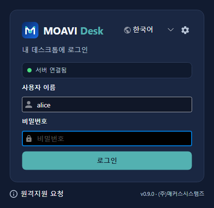
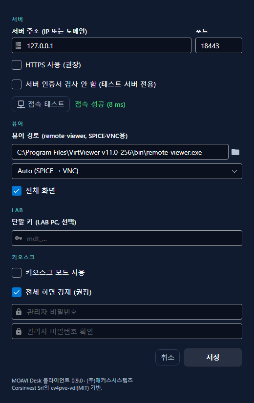
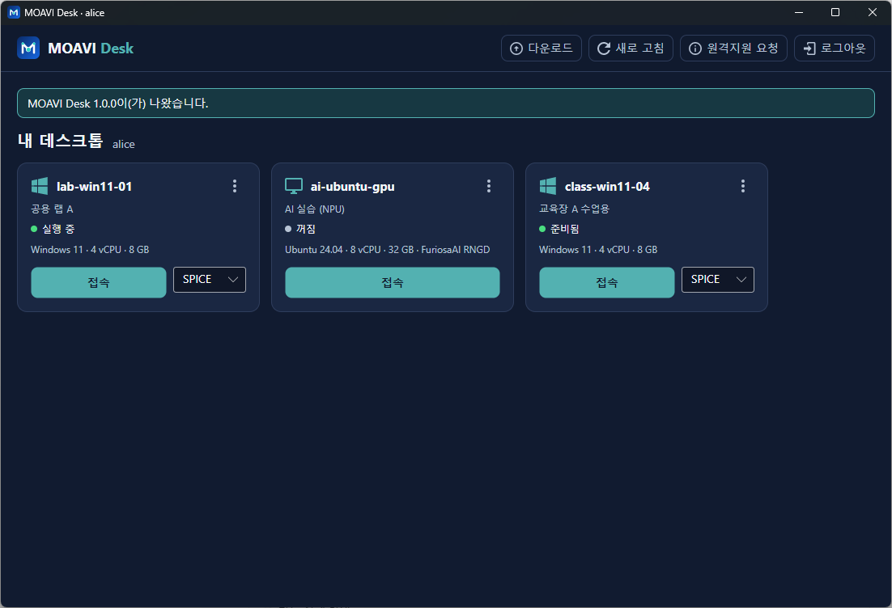

# MOAVI Desk Client (Windows)


MOAVI Desk 사용자가 설치해 쓰는 Windows 클라이언트입니다. 브라우저(HTML5 콘솔) 없이 내 데스크톱을
SPICE 또는 VNC로 엽니다. (주)매커스시스템즈 MOAVI Desk 서버에 붙습니다.

| 로그인 | 설정 | 내 데스크톱 |
|---|---|---|
|  |  |  |

## 하는 일

- **서버 설정**: 설정(톱니바퀴)에서 서버 주소(IP 또는 도메인), 포트, HTTPS를 정하고 **접속 테스트**로
  MOAVI Desk 서버가 응답하는지(응답 시간) 확인한 뒤 저장합니다. 키오스크 모드에서는 관리자 비밀번호가 있어야 열립니다.
- **로그인**: 사용자 이름과 비밀번호만 입력합니다. 서버 주소는 화면에 나오지 않고, 대신 서버 연결 상태
  (연결됨 / 연결할 수 없음 / 설정 안 됨)를 15초마다 확인해 보여 줍니다. 계정이 OTP를 쓰면 OTP 칸이 열립니다.
- **내 데스크톱**: 배정된 데스크톱을 카드로 보여 줍니다(상태, 사양, 프로토콜). 20초마다 새로 고칩니다.
  메뉴에서 시작, 다시 시작, 종료를 할 수 있습니다.
- **접속**
  - SPICE: 엔진이 준 `.vv` 파일로 remote-viewer를 엽니다. USB, 오디오, 다중 모니터를 쓸 수 있습니다.
  - VNC: 엔진의 콘솔 웹소켓을 로컬 TCP 포트로 이어 주고(브리지), remote-viewer가 그 포트에 붙습니다.
  - 뷰어를 닫으면 세션이 끝납니다 (`/api/vlab/sessions/<id>/end`).
- **LAB PC**: 설정에 단말 키(`mdt_…`, 관리자 콘솔 → 단말 관리)를 넣으면, 로그인하자마자 그 실습실의
  현재 수업 데스크톱이 전체 화면으로 열립니다. 뷰어를 닫으면 로그아웃되어 다음 사람이 씁니다.
  키오스크 모드(전체 화면, 종료 시 관리자 비밀번호)와 함께 쓰고, 단말은 MAC으로 등록됩니다.
- **업데이트**: 엔진의 `/api/vlab/client/config`가 알려 주는 최신 버전이면 다운로드 버튼을 보여 주고,
  최소 버전보다 낮으면 로그인을 막고 다운로드 페이지를 엽니다.
- **원격지원 요청**: 화이트라벨의 지원 URL, 없으면 https://support.makussystems.co.kr/ 을 엽니다.
- 한국어와 영어. 설정은 `%USERPROFILE%\.moavi-desk\config`에 저장합니다.

## 빌드

```
dotnet build src/MoaviDesk/MoaviDesk.csproj -c Release
dotnet publish src/MoaviDesk/MoaviDesk.csproj -c Release -r win-x64
```

.NET 10 SDK가 필요합니다. 결과물은 `moavi-desk.exe` 한 파일입니다.

## 남은 일

- 설치 프로그램(MSI): virt-viewer(remote-viewer)와 UsbDk를 같이 설치. 클라이언트는
  `virt-viewer\bin\remote-viewer.exe`(설치 폴더 안)나 `C:\Program Files\VirtViewer*`를 먼저 찾습니다.
- 코드 서명: 인증서(Microsoft Trusted Signing 또는 OV/EV)가 생기면 exe와 MSI에 서명합니다.
  서명 전에는 SmartScreen 경고가 뜹니다.
- 실제 클러스터에서 SPICE/VNC 접속 확인.

## 라이선스

MIT ([LICENSE.md](LICENSE.md)). 포함된 오픈소스 구성요소는 [3rd-party-licenses.md](3rd-party-licenses.md)에 있습니다.
